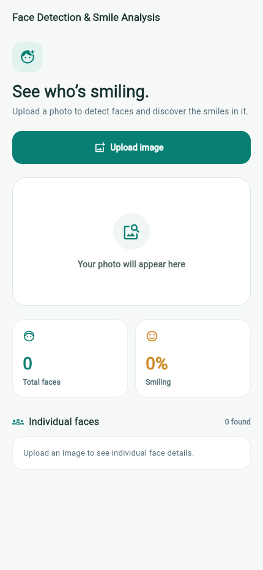
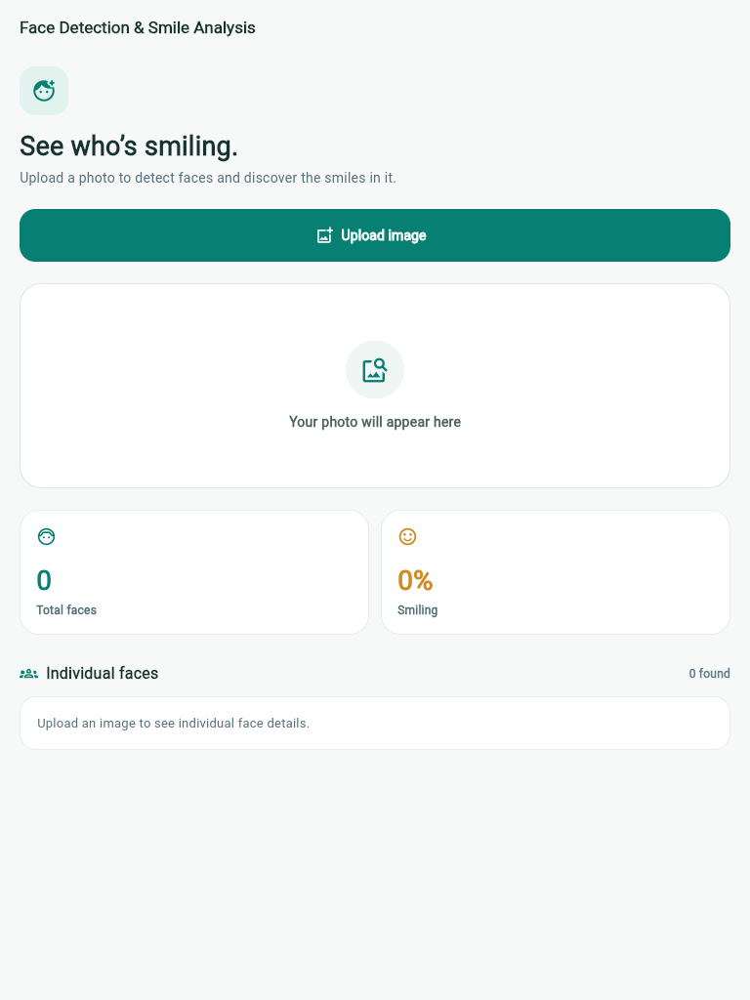

<div align="center">

# Face Detection & Smile Analysis

**A Flutter app for on-device face detection and smile insights.**

Select a photo, see every detected face highlighted, and explore smile
probabilities with Google ML Kit.

</div>

<p align="center">
  
  &nbsp;&nbsp;
  
</p>

## Overview

Face Detection & Smile Analysis lets you choose an image from your device
gallery and analyze it on-device. The app displays face bounding boxes, a
total-face count, the percentage of smiling faces, and individual smile
probabilities.

> The screenshots show the app's initial state before an image is selected.

## Features

- Choose an image from the device gallery, with an option to select another.
- Detect multiple faces in a single image using Google ML Kit.
- Draw a labeled bounding box around each detected face.
- Show the total number of faces and the percentage of smiling faces.
- Display each face's smile status and smile probability.
- Treat a face as smiling when its smile probability is **70% or higher**.
- Show **0%** smiling when no faces are detected.

## Smile calculation

The app classifies each detected face using ML Kit's smile probability:

```text
smiling percentage = smiling faces / total detected faces × 100
```

A face counts as smiling at a probability of `0.7` or greater. If the image
contains no detected faces, the smiling percentage is `0%`.

## Getting started

### Requirements

- Flutter SDK compatible with the project's Dart SDK constraint.
- Android or iOS device/emulator.

Face detection uses native Google ML Kit APIs; the app is intended for Android
and iOS rather than Flutter web or desktop.

### Run locally

```shell
flutter pub get
flutter run
```

### Validate

```shell
flutter analyze
flutter test
flutter build apk --debug
```

## Technology

| Technology | Purpose |
| --- | --- |
| Flutter | Cross-platform application UI |
| `google_mlkit_face_detection` | On-device face detection and smile classification |
| `image_picker` | Device gallery image selection |

## Project structure

The code is organized feature-first using MVC:

```text
lib/
├── main.dart
└── features/
    └── face_analysis/
        ├── controller/
        │   └── face_analysis_controller.dart
        ├── model/
        │   └── face_analysis_result.dart
        └── view/
            ├── face_analysis_page.dart
            └── widgets/
                ├── face_analysis_widgets.dart
                └── face_image_preview.dart
```

- **Model** — stores face-analysis results and derives the face and smile
  metrics.
- **Controller** — selects gallery images and coordinates image decoding and
  ML Kit analysis.
- **View** — presents the upload flow, image overlay, analytics, and
  per-face information.

## Privacy

Image selection and face analysis are performed on-device. This app does not
include a backend service for uploading selected photos.
